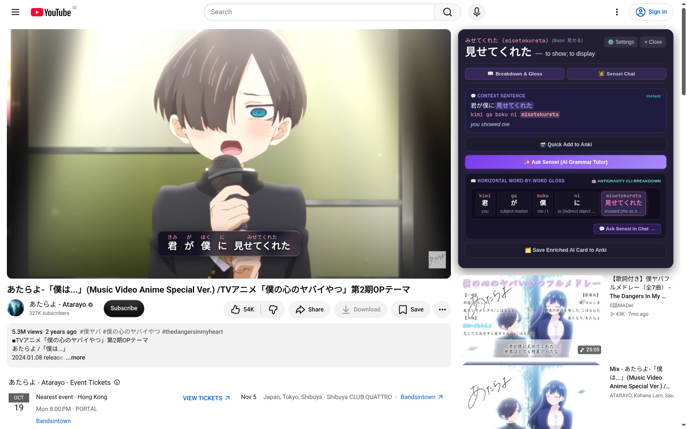
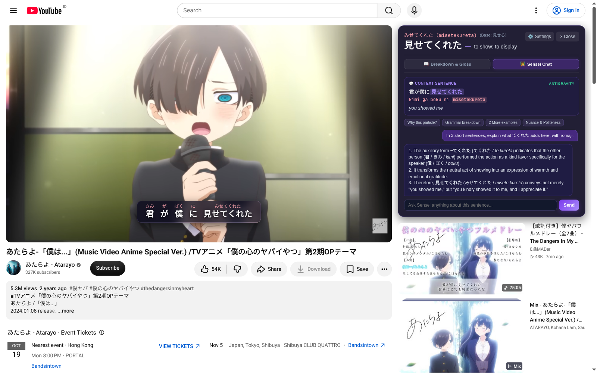

<p align="center">
  
</p>

<h1 align="center">LinguaPlay — Japanese Video Learning</h1>

<p align="center">
  <strong>Learn Japanese from the videos you already love.</strong><br>
  Clickable subtitles, sentence meanings, contextual explanations, and Anki cards on YouTube and streaming video sites.
</p>

<p align="center">
  Chrome / Chromium extension · Manifest V3<br>
  <a href="#install-the-extension">Install</a> ·
  <a href="#how-it-works-on-youtube">How it works</a> ·
  <a href="#connect-your-ai-tutor">AI setup</a> ·
  <a href="docs/settings.md">Settings tutorial</a> ·
  <a href="docs/local-backend.md">Local backend</a>
</p>



*Watch a Japanese video. Click an unfamiliar word. Understand it in context. Keep it for review.*

Screenshots below show LinguaPlay on the real YouTube watch page for [Atarayo — 「僕は...」](https://www.youtube.com/watch?v=5tABGeWbVtQ).

LinguaPlay adds a Japanese learning workspace to YouTube's watch page. Subtitles become words you can click, and a learning drawer sits beside the video with readings, definitions, translation, and AI assistance. You can follow the video and study a line in the same tab.

## How it works on YouTube

### 1. Open a video and read along

Open a YouTube video with Japanese captions. LinguaPlay detects the captions and displays an interactive Japanese overlay with **furigana** above the words.

Use the **言** control in the video player to open LinguaPlay's toolbar. Use the reading dropdown to choose **Furigana**, **Romaji**, or **Japanese only**. The compact toolbar keeps its reading dropdown and **Subtitles** action visible; **More (⋯)** contains Repeat, Import, Lyrics, and extension settings. The **eye** control shows or hides the Japanese subtitle overlay and learning drawer. To watch with original subtitles, hide the Japanese overlay with the eye control and turn on YouTube's **CC** button.

Click the toolbar's **power** button to turn the app off and restore native captions. Click **言** again to turn it back on.

Open **Subtitles** to find episode subtitles or change **English below Japanese**, **Subtitle size**, **Horizontal/Vertical position**, and **Background opacity**. Scroll to the appearance controls at the bottom. Subtitle size ranges from 50–200%, updates Japanese/readings/English together, and is saved automatically after adjustment; **Default size** restores 100%. Position sliders move the full subtitle block left/right and bottom/top within the available video area; their values are saved after adjustment, and **Default position** restores bottom-center placement. Sentence meanings appear inside the Japanese caption strip and use Google Translate first. If Google fails or rate limits requests, LinguaPlay automatically tries your configured 9Router model or combo. Google rate limits pause further Google requests for 1–5 minutes. Hover **Retry sentence meaning** to see the error if both services are unavailable.

For music videos without captions, choose **More (⋯) → Find lyrics** to search for synced lyrics by track and artist. You can also use **More (⋯) → Import subtitles** to load a Japanese `.srt`, `.vtt`, `.ass`, `.ssa`, or `.lrc` file. Adjust the timing offset or use **Sync Line 1 to Playhead** in the Lyrics Manager when the text is out of sync.

Your latest manual file or lyrics selection stays active until you choose another source or leave the video. While the overlay is hidden, LinguaPlay leaves your native caption language and CC choice alone.

### Choose the right source for songs and episodes

In **言 → Subtitles → Watching**, choose a mode for the current video:

- **Song — synced lyrics:** use the existing LRCLIB/Kugou lyrics search, cache and song-identification workflow. Jimaku controls stay hidden. The subtitle badge opens the Lyrics Manager.
- **Episode — captions / Jimaku:** use video captions or choose an episode subtitle file. Song searches and old song caches are ignored.
- **Auto:** retain the existing YouTube captions-first, lyrics-fallback behavior. On streaming sites, start with episode subtitles. The badge follows the active source.

Your manual choice is saved per video and restored on reload. It does not carry into another episode or song. Choosing **More → Find lyrics** also selects Song mode for that video. Mode changes clear the previous source and reject its pending results; your reading, size, position and opacity preferences stay available.

### 2. Click a word to understand the sentence

Click any word in the subtitle overlay. Playback pauses and LinguaPlay opens its drawer in YouTube's sidebar.

- **Word and reading:** check the Japanese word, hiragana reading, romaji, and dictionary meaning.
- **Context sentence:** see the original line, its romaji, and English translation.
- **Breakdown & Gloss:** click **Ask Sensei (AI Grammar Tutor)** to get an AI word-by-word gloss.

The drawer keeps the sentence you selected as its context, even if playback moves on. When you're ready, close the drawer and resume the video.

### 3. Ask Sensei a follow-up question

Switch to **Sensei Chat** to ask about the selected sentence. Use a prompt such as **Why this particle?**, **Grammar breakdown**, **2 More examples**, or **Nuance & Politeness** — or type your own question.



Sensei uses the model or combo configured in 9Router. Its answers depend on the model and should be checked when a reading or explanation seems uncertain.

### 4. Save useful words to Anki

Click **Quick Add to Anki** to save the selected word with its reading, meaning, and sentence context. After an AI breakdown, **Save Enriched AI Card to Anki** saves an enriched card.

Both buttons use your configured AnkiConnect URL and deck and keep a local copy. Create that deck in Anki first. The result states what completed: **Added to Anki · stored locally**, **Kept locally — Anki: …**, or a local-storage failure. An existing duplicate is reported as **Already in Anki**. Kana readings and romaji are stored separately.

Click the extension's toolbar icon to open Settings and choose **Export TSV File** to export the collection later. The export contains sentence, word, kana reading, and meaning columns, including the sentence translation when available. The TSV retains the historical `LinguaPlay Japanese Immersion` deck header.

## Jimaku on Netflix and other video sites

The extension also attaches to visible HTML5 players on **Netflix, Prime Video, Disney+, Hulu, Crunchyroll, and Vimeo**. Open the site in your browser, start its player, and use the green **Subtitles** badge or **言 → Subtitles**. YouTube retains its automatic caption and lyrics support; other sites use Jimaku/local files, with Japanese live text captured where available.

1. Create a [Jimaku account](https://jimaku.cc/account) and generate an API key. In extension **Settings → Reading → Jimaku subtitles**, enter the key and click **Save Settings**.
2. Open **Subtitles** in the video. Search by Japanese, English, or romaji title, choose **Anime** or **Live action**, and optionally enter an episode number.
3. Choose a title and subtitle file. Preview its first lines, then click **Use selected subtitles**. Previewing keeps the current source active.
4. Adjust **Subtitle delay** if the release does not match your video. Positive values show subtitles later. **Sync first line to playhead** aligns the first cue with the video's current position.

SRT, VTT, ASS, SSA and LRC files up to 10 MB are supported, including UTF-8, UTF-16 BOM and Shift_JIS text. Extract ZIP/RAR/7z archives before using **Import subtitle file**. Local import works without a Jimaku key. Jimaku supplies subtitle text; you watch video through the streaming site's usual player.

The study panel follows [LangPlay's current player design](https://github.com/Marsel204/LangPlay/tree/main/integrations/seanime). Clicking a word pauses and captures the sentence with per-word romaji/glosses and English. **Close** or **Escape** keeps playback paused; **Resume watching** explicitly resumes it. Reading modes, English captions and background opacity are separate controls.

Site-provided fullscreen keeps the extension inside the player. Native fullscreen of the `<video>` element alone cannot contain extension controls. Chromium tests use intercepted site pages and fixture Jimaku responses; live subscription-site layouts and authenticated Jimaku access require account testing. See the [implementation scope](docs/specs/langplay-player-and-jimaku.md) and [verification results](docs/player-verification.md).

## Install the extension

No build step is needed.

1. Clone or download this repository:

   ```bash
   git clone https://github.com/Marsel204/LangPlayeExt.git
   ```

2. Open `chrome://extensions` in Chrome or Chromium.
3. Enable **Developer mode**, click **Load unpacked**, and select the repository root — the folder containing `manifest.json`.
4. Pin **LinguaPlay** to your toolbar.
5. Click the extension's toolbar icon to open Settings. Expand **Settings setup guide**, or follow the [settings tutorial](docs/settings.md). Configure 9Router and click **Save Settings**.
6. Open a YouTube watch page. Refresh an already-open page so the extension can load.

Japanese subtitle interaction, reading modes, and the offline card collection work without an AI API key. AI breakdowns and chat require a configured 9Router connection. More accurate contextual readings use the optional Sudachi backend.

## Connect your AI tutor

LinguaPlay uses **9Router** for Sensei Chat, grammar breakdowns, and AI song identification. Click the extension's toolbar icon to open Settings and configure its URL, router key, and model or combo.

New to the settings? Follow the [settings setup guide](docs/settings.md) for a complete walkthrough, field reference, and troubleshooting. For login startup, see [Start 9Router automatically](docs/9router-autostart.md).

[9Router](https://github.com/decolua/9router) manages your AI providers, credentials, and fallback combos behind one OpenAI-compatible API. Run it separately from the extension:

```bash
npm install -g 9router
9router
```

1. Open the 9Router dashboard at `http://localhost:20128`, connect your providers, and copy the router API key if authentication is enabled.
2. Click the LinguaPlay toolbar icon to open the 9Router settings.
3. Keep `http://127.0.0.1:20128/v1` for a router on the same computer, or enter your hosted router's API base URL. Enter the **router** key here; upstream provider keys stay in 9Router.
4. Search **Find your provider** by name or prefix (for example, `OpenCode` or `oc`), choose your **Provider**, then select an ID from **Available Models**. Only that provider's models appear; router combos are grouped under **Combos & unprefixed models**. The catalog loads automatically when browser access is already allowed; **Load Models** refreshes it or requests access to a hosted router. Selecting a model fills **Model or Combo** with its exact ID. You can also enter a model or combo there manually.
5. Click **Test 9Router** to send a short AI request, then **Save Settings**.

Sensei Chat, grammar breakdowns, and AI song identification use only the configured 9Router model or combo. Enter the router key in extension Options; upstream credentials stay in 9Router. Keep 9Router running while using these features. On Linux / Omarchy, **Settings → AI tutor → Start 9Router at login** enables background startup. If the helper is missing, download the setup script there and run it once on that computer. See [automatic startup](docs/9router-autostart.md) for the steps and other platforms.

For optional offline **Sudachi** parsing and automatic parser startup on Linux, see the [local backend setup guide](docs/local-backend.md). The parser improves contextual readings and dictionary forms; subtitle fallback readings work without it.

Saving or testing a remote 9Router, parser/server, or AnkiConnect endpoint may ask for access to its origin. Denying access leaves existing settings intact. Default HTTP endpoints on `127.0.0.1` and `localhost` work on any port without an extra grant.

## Connect Anki

1. Install [AnkiConnect](https://ankiweb.net/shared/info/2055492159) in Anki using add-on code `2055492159`, then restart Anki.
2. Keep Anki open. Its default endpoint is `http://127.0.0.1:8765`.
3. In LinguaPlay Options, set your deck name — default: **LinguaPlay** — and click **Test AnkiConnect**.
4. Save your settings and add a word from the YouTube subtitle drawer.

You can also start with the offline collection and export your cards later.

## Troubleshooting

| Problem | What to try |
| --- | --- |
| **No extension controls** | Reload the extension in `chrome://extensions`, then refresh the YouTube watch page. |
| **No Japanese text** | Enable Japanese captions, search with **Lyrics**, or upload a subtitle file with the folder button. Availability varies by video. |
| **Text is out of sync** | Adjust the toolbar offset or use the Lyrics Manager's playhead sync tools. |
| **AI isn't responding** | Test 9Router in Options. Check the router key, model or combo, URL, and that 9Router is running. |
| **A reading looks wrong** | Use the updated Sudachi backend for contextual parsing. Names and ambiguous words may still need checking. |
| **A card isn't in Anki** | Check that AnkiConnect is available. Look in the extension collection for cards saved while Anki was offline. |

## Extension and standalone app

This repository contains the **YouTube extension**. Its toolbar icon opens Settings directly; all learning tools run on the YouTube watch page.

The standalone video player and companion Python backend live in the separate [LangPlay app repository](https://github.com/Marsel204/LangPlay). Use that project for local video playback. The extension connects to its optional backend over HTTP for offline Sudachi parsing; it does not bundle or launch the standalone player.

<details>
<summary><strong>Contributor notes and checks</strong></summary>

The extension uses plain JavaScript, HTML, and CSS. `content.js` and `content.css` implement the YouTube interface; `background.js` handles extension requests and toolbar clicks; `options.*` provide Settings. `js/` contains the YouTube bridge and parser client, `lib/` contains reading libraries, and `native/` contains the optional Linux backend launcher.

`build_content_js.py` generates `content.js` using the extension's reading data in `data/kanji-dict.js`. When changing the YouTube interface, update the generator and regenerate the bundle:

```bash
python3 build_content_js.py
```

On a committed tree, `python3 -I build_content_js.py && git diff --exit-code content.js` checks generator correspondence. During development, save the bundle before regeneration and compare it with `cmp`. Reading tests load the shipped engine; `data/kanji-dict.js` contains reading data only.

Run the extension checks:

```bash
node --test tests/test_*.js
node run_tests.js
python3 tests/test_native_host.py
python3 tests/test_router_autostart.py
node tests/browser_custom_ai.mjs
node tests/browser_anki_youtube.mjs
node tests/browser_captions_youtube.mjs
node tests/browser_video_sites.mjs
LP_REVIEW_MODE=after node tests/review/lib/worker.js
```

The browser checks require Chromium and use disposable profiles and local test APIs. They do not invoke an AI model. The Anki check verifies YouTube Quick Add through the service worker against AnkiConnect's default CORS policy. The captions check verifies backend transport and rendered cues on YouTube with default browser security, with and without backend CORS headers. Set `CHROMIUM_PATH` if your executable has another name. See the [backend guide](docs/local-backend.md) for real Sudachi integration checks.

The code-review regressions and performance harness are in `tests/review` and `tests/perf`. Their baseline evidence and fix report are under `docs/reviews/2026-10-28`. The counts in `PARSING_VERIFICATION.md` describe an earlier snapshot.

</details>
